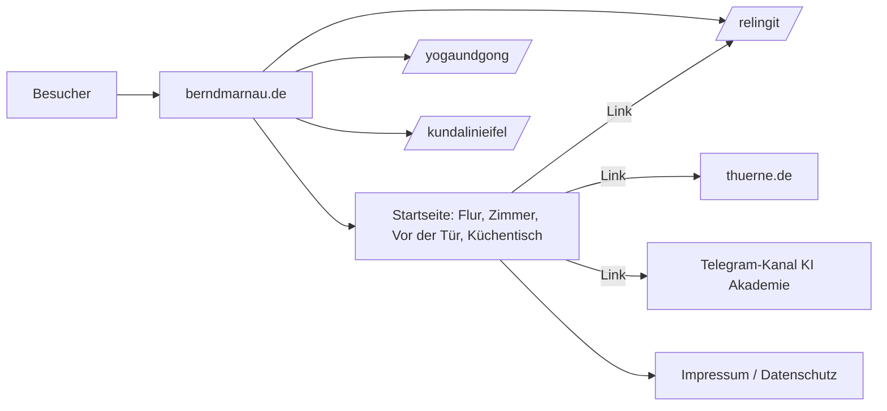

# Architektur (ADF) und Technik (TDF)

## ADF – Sicht: Betrachter, Seiten, Schnittstellen

### Schnittstellen

| ID | Typ | Von → Nach | Beschreibung |
|---|---|---|---|
| IF-01 | logisch | Startseite → /relingit/ | einfacher Link, kein Datenaustausch |
| IF-02 | logisch | Startseite → thuerne.de, t.me | einfache Links nach außen; Datenfluss erst nach Klick |
| IF-03 | physisch | Repo → Webserver | manueller Upload gemäß deploy-manifest.yaml |
| IF-04 | logisch | Betrachter → E-Mail | mailto, kein Formular (Adresse offen) |

## TDF – technische Beschreibung

- Auslieferung statisch; keine Server-Skripte, keine Datenbank
- Layout: Flexbox mit Umbruch, `rem`-Einheiten, Breakpoint bei 40 rem
- Schriften: woff2 lokal, `font-display: swap`
- Barrierefreiheit: Sprunglink, Landmarken, sichtbarer Fokus, Alternativtext, Kontrastprüfung
- Bewegung: nur weiches Scrollen, und nur wenn der Nutzer keine Bewegungsreduktion wünscht

## Risiken

| ID | Risiko | Maßnahme |
|---|---|---|
| R1 | MIT-Lizenz würde fremde Medien erfassen | NOTICE trennt Code und Inhalte |
| R2 | Private Daten in öffentlicher Historie | Zwei-Repo-Konzept, PR-Review |
| R3 | Deployment löscht Projektverzeichnisse (SPoF Upload) | Manifest, keine Spiegelung, Nachkontrolle |
| R4 | Impressum/Datenschutz unvollständig | Entwurf markiert, `release-check` blockiert |
| R5 | Hoster ungeklärt (Logfiles, AVV) | offene Frage im Datenschutzkonzept |
| R6 | Verwaltungs-Panel-Link auf der Seite | REQ-042 |
